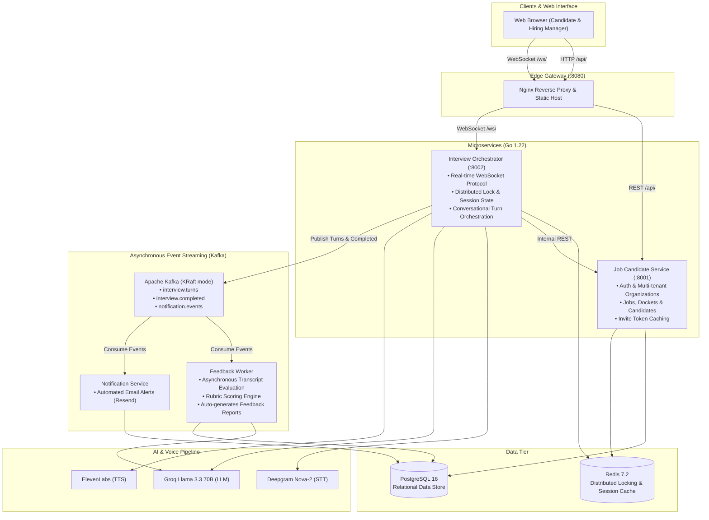

# AI Interview Platform

An enterprise AI-powered interview platform designed for automated, structured technical and behavioral candidate assessments with real-time voice streaming and asynchronous evaluation reports.

---

## Architecture & Tech Stack

- **Go 1.22** microservices
- **PostgreSQL 16**: Relational storage for organizations, users, job roles, interview dockets, candidates, invites, interviews, and feedback reports
- **Redis 7.2**: Distributed session state, invite token caching, and distributed concurrency locking
- **Apache Kafka 3.7 (KRaft mode)**: Asynchronous event streams (`interview.turns`, `interview.completed`, `notification.events`)
- **Nginx Reverse Proxy & Static Web Host**: Directs HTTP `/api/` traffic to `job-candidate-service`, upgrades WebSocket `/ws/` traffic to `interview-orchestrator`, and serves the frontend dashboard at port `8080` (declarative Apache APISIX routes also available in `gateway/apisix/`)
- **AI & Voice Pipeline**:
  - **Speech-to-Text (STT)**: Deepgram Nova-2 streaming transcription
  - **LLM Engine**: Groq (Llama 3.3 70B Versatile) for ultra-low latency streaming turns, with OpenAI / Anthropic fallback pool and offline demo mode
  - **Text-to-Speech (TTS)**: ElevenLabs streaming voice synthesis
### High Level Design (HLD) Architecture



---

## Services & Ports

| Service | Internal Port | Host Port | Description |
| :--- | :--- | :--- | :--- |
| **Frontend / Reverse Proxy** | `:80` | `http://localhost:8080` | Web UI & API Gateway routing |
| **Job Candidate Service** | `:8001` | `127.0.0.1:8003` | REST API for auth, jobs, dockets, candidates, and invites |
| **Interview Orchestrator** | `:8002` | `127.0.0.1:8004` | WebSocket service managing real-time voice turns & AI dialogue |
| **Feedback Worker** | — | — | Kafka consumer analyzing interview transcripts to generate structured rubric reports |
| **Notification Service** | — | — | Kafka consumer dispatching invite and completion alerts (Resend) |
| **PostgreSQL** | `:5432` | `127.0.0.1:5432` | Primary database |
| **Redis** | `:6379` | `127.0.0.1:6379` | Distributed cache and locking |
| **Kafka** | `:9092` | `127.0.0.1:9092` | Event broker |

---

## Quick Start

### 1. Prerequisites
- Docker & Docker Compose
- (Optional for local testing without Docker) Go 1.22+

### 2. Configure Environment Variables
Copy `.env.example` to `.env` and configure your credentials:
```bash
cp .env.example .env
```
> **Tip:** You can set `INTERVIEW_DEMO_MODE=true` in `.env` to run the entire interview flow locally without needing paid Deepgram, Groq, or ElevenLabs API keys.

### 3. Start the Entire Platform
```bash
# Build and start all services in the background
docker compose up -d

# Run database migrations (run automatically on startup, or manually via):
docker compose run --rm migrate
```

### 4. Access the Application
Open your browser and navigate to:
```
http://localhost:8080
```

---

## End-to-End Walkthrough

1. **Hiring Manager Sign-up & Login**:
   - Navigate to `http://localhost:8080` and click the **Register** tab to create an organization and manager account.
2. **Create a Job Role**:
   - Specify role title (e.g. *Senior Backend Engineer*), description, and required skills.
3. **Create an Interview Docket**:
   - Set instructions, interview duration, specific questions to ask, and rubric evaluation criteria (e.g., *System Design*, *Problem Solving* with max scores).
4. **Add Candidate & Generate Invite Link**:
   - Add candidate name and email, then generate a unique invite link.
5. **Conduct the Candidate Interview**:
   - Open the invite link in a browser tab.
   - Click **Connect to interview** to begin. The AI welcomes the candidate and initiates the voice interview using the docket questions.
   - Speak into your microphone and click **Start speaking** / **Stop speaking** to send turns.
   - When finished, click **Complete interview**.
6. **Automatic Evaluation Report**:
   - The `feedback-worker` consumes the interview events from Kafka, evaluates the candidate transcript against the rubric criteria using the LLM, and publishes a structured evaluation report.
   - View the feedback report, score breakdown, and strengths/weaknesses directly on the Hiring Manager dashboard.

---

## Development & Testing

```bash
# Stop all containers
docker compose down

# View live service logs
docker compose logs -f

# Run unit and integration tests
cd services/job-candidate-service && go test ./...
cd services/interview-orchestrator && go test ./...
```
