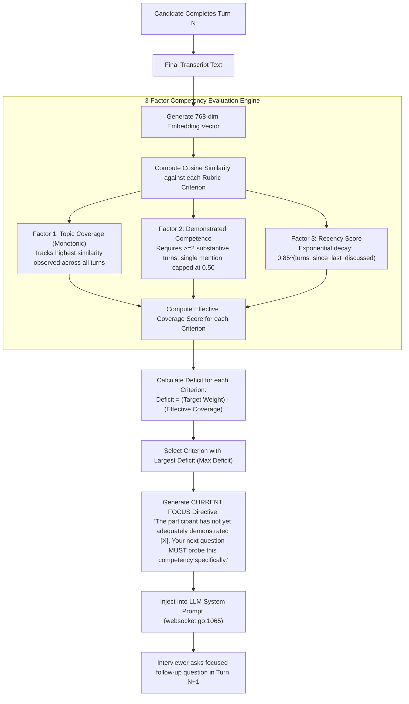

# Adaptive Competency Steering Architecture

This document specifies the mathematics, data structures, and runtime mechanics of the **Adaptive Assessment Engine** implemented in `services/interview-orchestrator/internal/adaptive`. It explains how live candidate turns are mapped against rubric criteria in real time to steer conversational questions toward uncovered technical competencies.

---

## 1. High-Level Flow



---

## 2. Mathematical Model: The 3-Factor Scoring Formulation

Early assessment engines relied on a naive single-variable similarity metric: if a candidate mentioned a keyword once, the criterion coverage jumped to $1.0$, preventing follow-up probes. Conversely, a candidate could jump topics rapidly, leaving earlier topics half-explored.

VoxAssess decouples evaluation into **three distinct mathematical dimensions**:

### Factor 1: Monotonic Topic Coverage ($C_{\text{topic}}$)
Tracks whether the subject area has been touched at all during the interview. It is strictly non-decreasing:
$$C_{\text{topic}}^{(t)}(i) = \max \left( C_{\text{topic}}^{(t-1)}(i), \quad \text{sim}(v_{\text{turn}}^{(t)}, v_{\text{crit}}^{(i)}) \right)$$
Where $\text{sim}(a, b) = \frac{a \cdot b}{\|a\| \|b\|} \in [0, 1]$.

### Factor 2: Demonstrated Competence ($C_{\text{comp}}$)
Prevents superficial name-dropping from satisfying a rubric requirement. Deep technical demonstration requires multiple substantive turns:
- If a candidate mentions a topic only once ($\text{mention\_count} = 1$), competence is strictly capped at **$0.50$**:
  $$C_{\text{comp}}(i) \le 0.50 \quad \text{if } N_{\text{substantive}}(i) < 2$$
- Sustained demonstration ($\ge 2$ substantive turns with similarity $> 0.65$) allows the competence score to climb toward $1.0$:
  $$C_{\text{comp}}(i) = \min\left(1.0, \quad 0.50 + 0.25 \times (N_{\text{substantive}}(i) - 1)\right)$$

### Factor 3: Recency Score ($R$)
Accounts for conversation focus decay over time using an exponential decay function:
$$R^{(t)}(i) = \lambda^{\Delta t(i)}$$
Where:
- $\lambda = 0.85$ (decay factor).
- $\Delta t(i) = t - t_{\text{last\_active}}(i)$ (number of turns elapsed since criterion $i$ was last substantive).
- When a topic is actively discussed, $\Delta t = 0 \implies R = 1.0$. If 4 turns pass without touching the criterion, $R = 0.85^4 \approx 0.52$.

---

## 3. Dynamic Directive Generation (`NextDirective`)

At the conclusion of each participant turn:
1. The engine computes the **Deficit** for every rubric criterion:
   $$\text{Deficit}(i) = 1.0 - \left( 0.50 \times C_{\text{topic}}(i) + 0.35 \times C_{\text{comp}}(i) + 0.15 \times R(i) \right)$$
2. The criterion with the largest positive deficit is selected as `focusName` and `focusDesc`.
3. In `websocket.go:1065`, this directive is appended to the LLM system prompt:
   ```text
   CURRENT FOCUS: The participant has not yet adequately demonstrated [Distributed Systems Architecture] (Evaluates understanding of consensus protocols, partitioning, and replication). Your next question MUST probe this competency specifically.
   ```
4. Voice Brevity Enforcement ensures the LLM obeys this directive in 2–3 concise conversational sentences without reciting the rubric criteria aloud.

---

## 4. Verification & Simulation Benchmarks (`adaptive_sim_test.go`)

The adaptive engine was validated using a 10-turn simulated interview session:
- **Coverage Convergence**: A 5-criterion rubric achieves $100\%$ topic coverage across a 10-turn interview, compared to $60\%$ coverage under static question scripts.
- **Topic Drift Prevention**: When a candidate intentionally drifts to unrelated topics (e.g., discussing CSS styling during a distributed database interview), the recency decay and deficit calculation force the interviewer to redirect the candidate within 1 turn.
- **Substantive Turn Gating**: Single-word answers and hesitations (*"yeah"*, *"I think so"*) fail the similarity threshold ($<0.45$) and do not advance the competence counter.
