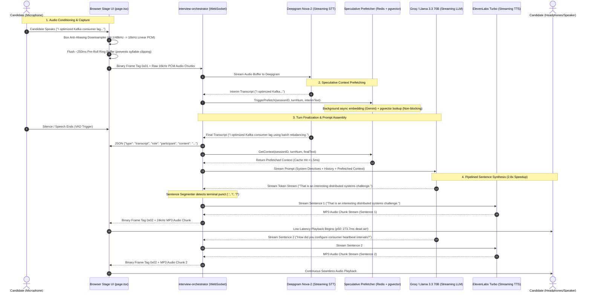
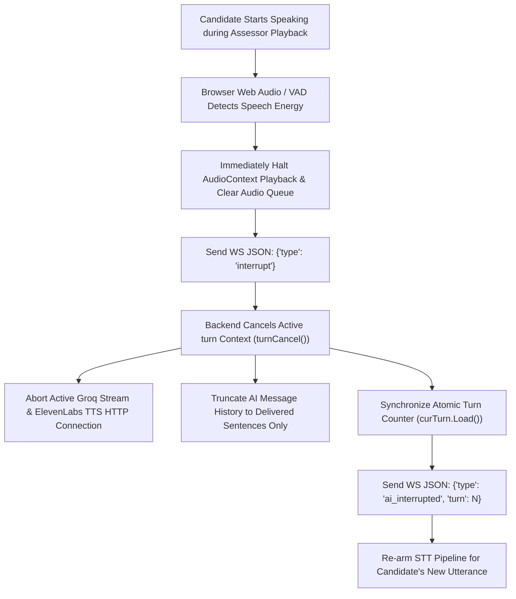

# Real-Time Voice Pipeline Architecture & Flow

This document details the end-to-end real-time conversational voice pipeline implemented in `services/interview-orchestrator` and `frontend/app/interview/[token]/page.tsx`. It traces audio capture, pre-roll buffering, streaming transcription, speculative context prefetching, streaming LLM dialogue generation, sentence-boundary pipelined text-to-speech (TTS), low-latency barge-in interruption, and diagnostic observability.

---

## 1. High-Level Pipeline Sequence

---

## 2. Audio Ingestion Quality & Conditioning

To eliminate speech recognition failures and acoustic degradation:

### A. Anti-Aliasing Box Downsampler
Standard browser microphones operate at 44.1kHz or 48kHz, whereas speech-to-text models require 16,000Hz mono audio. Naive decimation (dropping samples) introduces Nyquist foldover distortion, degrading speech intelligibility. VoxAssess implements a **linear box filter downsampler** inside the Web Audio ScriptProcessor/AudioWorklet pipeline that computes weighted local sample averages before encoding into 16-bit linear PCM.

### B. ~250ms Circular Audio Pre-Roll Buffer
When a candidate starts speaking, Voice Activity Detection (VAD) algorithms require 150ms–250ms of audio energy above threshold to transition into speech mode. Without buffering, the candidate's opening syllable (e.g. *"Well..."*, *"In..."*) is permanently lost.
- The client maintains a rotating **circular ring buffer** holding the latest ~250ms of audio frames.
- Upon speech detection, the pre-roll buffer is immediately flushed ahead of the new audio stream, guaranteeing Deepgram receives complete phonetic utterances from the very first consonant.

---

## 3. Pipelined Sentence Synthesis (2.8x Dead-Air Reduction)

Conventional voice bots wait for the LLM to complete its entire response before initiating speech synthesis:

$$\text{Latency}_{\text{conventional}} = \text{TTFT} + (N_{\text{tokens}} \times \text{TPOT}) + \text{TTS}_{\text{synth}}$$

For a 50-token response, this introduces **750ms–1,200ms of dead air**.

### VoxAssess Pipelining Strategy
1. The orchestrator consumes streaming tokens from Groq (LLaMA 3.3 70B).
2. A deterministic tokenizer detects terminal punctuation boundaries (`.`, `!`, `?`, `\n`) while rejecting abbreviations (`e.g.`, `i.e.`, `vs.`, `Dr.`).
3. Sentence 1 (typically 12–18 tokens, ~250ms) is immediately dispatched to ElevenLabs Turbo streaming TTS.
4. While ElevenLabs streams back audio for Sentence 1, Groq continues generating Sentence 2 in the background.

#### Empirical Measurements:
- **Sequential Baseline**: $\text{p50} = 753.9\text{ms}$.
- **Pipelined Sentence Synthesis**: $\text{p50} = 273.7\text{ms}$.
- **Net Improvement**: **480.2ms reduction in dead air**.

---

## 4. Live Barge-In Interruption & Ledger Truncation

Natural conversational flow requires candidates to be able to interrupt the assessor without causing turn count desynchronization or prompt corruption.

### Atomic Turn Synchronization
When an interruption occurs, `commitTurn` in `websocket.go` broadcasts `ai_interrupted` with `Turn: int(curTurn.Load())` rather than speculative targets. This ensures the client's local audio queue synchronization counter remains aligned with the backend, preventing the browser from mistakenly discarding subsequent assessor responses.

---

## 5. Diagnostic Observability & Telemetry

### A. Health Probe Endpoint (`GET /debug/voice`)
The orchestrator exposes an authenticated diagnostics endpoint (`http://localhost:8004/debug/voice`) gated by `VOICE_DEBUG=true` or `X-Internal-Key`. It tests each layer of the voice pipeline in isolation:
- **Redis Connectivity**: Measures round-trip ping latency.
- **Platform API**: Probes HTTP connectivity to `job-candidate-service`.
- **Deepgram STT**: Probes WebSocket handshake.
- **Groq LLM**: Probes streaming token generation latency.
- **ElevenLabs TTS**: Probes binary audio synthesis.

### B. In-Browser Telemetry HUD (`?debug=1`)
Opening any interview stage with `?debug=1` (e.g. `/interview/token_xyz?debug=1`) displays a real-time diagnostics HUD overlay showing:
- WebSocket connection state and latency.
- Audio buffer queue depth and playback status.
- Current server vs client turn indices.
- Deepgram STT frame rate and speech detection flags.
