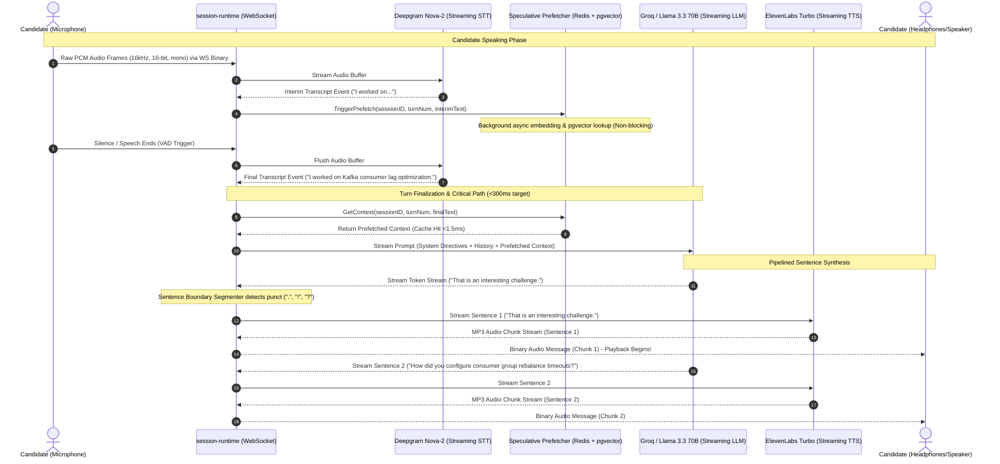
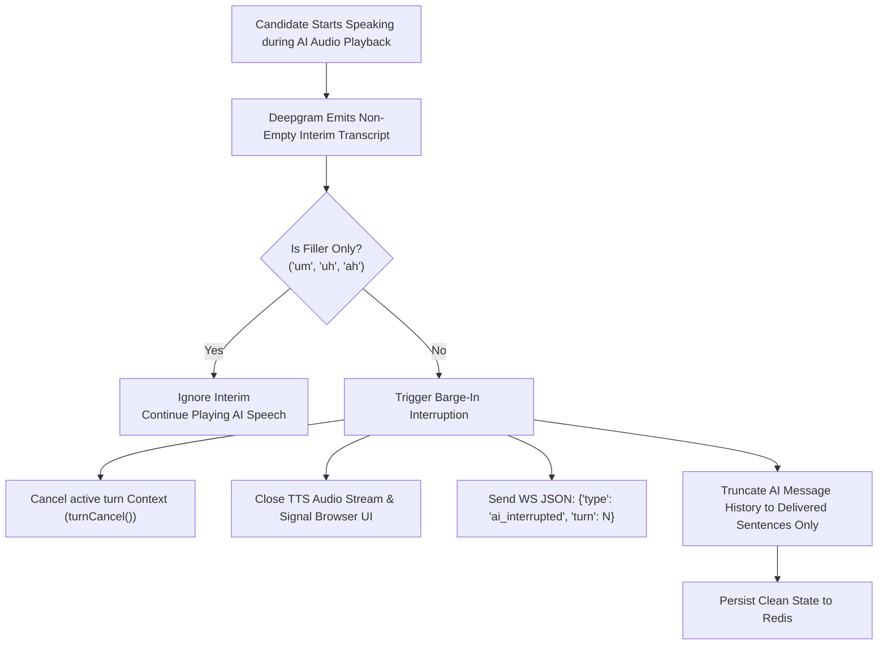

# Real-Time Voice Pipeline Architecture & Flow

This document details the end-to-end real-time conversational voice pipeline implemented in `services/interview-orchestrator`. It traces audio capture, streaming transcription, speculative context prefetching, streaming LLM dialogue generation, sentence-boundary pipelined text-to-speech (TTS), and low-latency barge-in interruption handling.

---

## 1. High-Level Pipeline Diagram

---

## 2. Component Breakdown & Protocols

### A. Audio Ingestion & Frame Streaming
- **Transport**: Persistent full-duplex WebSocket connection (`/ws/interview/{id}?token={token}`).
- **Audio Specification**: Linear PCM, 16,000 Hz sample rate, 16-bit depth, single-channel (mono).
- **Framing**: The browser client captures audio chunks via Web Audio API (`AudioWorkletNode`) every 100ms–250ms and streams them as raw binary WebSocket messages.
- **WebSocket Protocol**:
  - `BinaryMessage`: Raw PCM audio bytes forwarded immediately to the active STT session.
  - `TextMessage`: JSON control payloads (`session_start`, `ping`, `client_ready`).

### B. Streaming Speech-to-Text (STT)
- **Engine**: Deepgram Nova-2 Streaming API via WebSocket connection.
- **Interim vs. Final Events**:
  - `is_final == false`: Interim hypothesis emitted every ~150ms–300ms as speech progresses. Triggers the speculative retrieval prefetcher.
  - `is_final == true`: Speech utterance terminated by voice activity detection (VAD). Sent to `finalTranscriptChan` to initiate assessor dialogue generation.
- **Resilience & Auto-Reconnect**: If the Deepgram WebSocket drops mid-turn due to network timeout or provider reset, `websocket.go` detects the closed socket, instantiates a fresh connection with exponential backoff, and resumes streaming without aborting the candidate's interview session.

### C. Sentence Boundary Segmentation & Pipelined TTS
Conventional voice architectures wait for the LLM to generate an entire paragraph before dispatching text to a TTS engine, introducing 700ms–1,200ms of dead-air delay.

VoxAssess implements **Pipelined Sentence Synthesis**:
1. An asynchronous stream reader processes LLM tokens as they arrive over HTTP streaming.
2. A deterministic tokenizer detects terminal punctuation boundaries (`.`, `!`, `?`, `\n`) while filtering common abbreviations (`e.g.`, `i.e.`, `vs.`, `Dr.`, `Mr.`).
3. As soon as the first sentence boundary is resolved (typically 12–18 tokens, ~250ms), it is immediately dispatched to ElevenLabs Turbo streaming TTS.
4. Subsequent sentences are dispatched concurrently or enqueued sequentially, overlapping LLM generation of sentence $N+1$ with TTS synthesis of sentence $N$.

#### Measured Impact:
- **Baseline (Sequential Completion-Then-TTS)**: $\text{p50} = 753.9\text{ms}$.
- **Pipelined Sentence Synthesis**: $\text{p50} = 273.7\text{ms}$.
- **Speedup**: **2.8x reduction in candidate dead-air delay** (saving $480.2\text{ms}$).

---

## 3. Barge-In Interruption & History Truncation

A critical requirement of natural human dialogue is the ability to interrupt the speaker without desynchronizing state.

### Detailed Mechanics:
1. **Filler Filtering (`isFillerOnly`)**:
   Candidate hesitations such as *"um"*, *"uh"*, *"ah"*, or *"hmm"* do not trigger interruptions. The assessor continues speaking uninterrupted.
2. **Turn Context Cancellation**:
   When substantive speech is detected while `tc.isSpeaking() == true`, the active turn context is cancelled via `turnCancel()`. In-flight LLM HTTP requests and TTS streaming goroutines abort immediately.
3. **Audio Playback Cutoff**:
   The orchestrator sends an `ai_interrupted` WebSocket control frame to the browser. The frontend immediately halts its Web Audio buffer playback and clears the speaker queue.
4. **Delivered Text Truncation**:
   Only sentences that were completely synthesized and transmitted to the client prior to interruption are appended to `sess.ConversationHistory`. This prevents prompt hallucination in subsequent turns where the LLM assumes the candidate heard points that were cut off mid-sentence.

---

## 4. Sequence Barriers & Concurrency Controls

### Initial Greeting Completion Barrier
- **The Problem**: If a candidate speaks immediately upon connecting (or emits ambient noise), their audio could trigger Turn 2 while Turn 1 (the initial interviewer welcome greeting) is still generating or persisting, causing out-of-order turns and corrupted database history.
- **The Solution**: An explicit synchronization barrier (`initialGreetingDone chan struct{}`) blocks Goroutine C (the AI response generator) from processing participant input until the initial greeting turn has finalized its Kafka publication and database state save.

### Distributed Session Locking
- To prevent split-brain dual-tab sessions, `session-runtime` acquires a Redis distributed lock (`session:lock:{id}`) with a 30-second TTL upon WebSocket upgrade.
- An internal heartbeat goroutine refreshes the lock every 15 seconds. If a secondary connection attempts to attach to the same session, it is rejected with `409 Conflict`.
